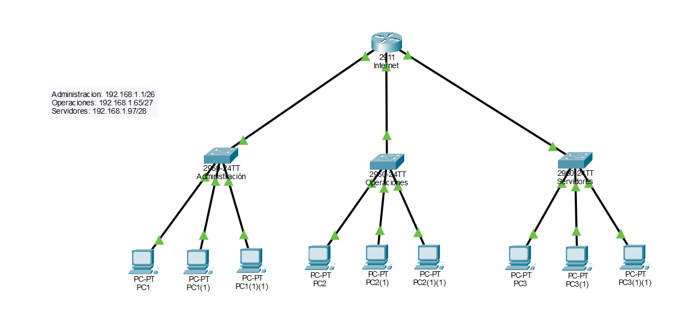

# Laboratorio 01: VLSM y conectividad IPv4 básica

## 1. Objetivo

Diseñar e implementar un esquema de direccionamiento IPv4 para una pequeña empresa, utilizando VLSM (*Variable Length Subnet Mask*) para dividir una red `/24` en subredes de distintos tamaños.

El laboratorio busca asignar direcciones IP de manera eficiente, evitar solapamientos, configurar los gateways correspondientes y verificar la conectividad mediante una simulación en Cisco Packet Tracer.

## 2. Escenario

Se dispone de la red `192.168.1.0/24` y se requiere segmentarla para tres áreas:

| Área | Capacidad requerida |
|---|---:|
| Administración | 50 dispositivos |
| Operaciones | 25 dispositivos |
| Servidores | 10 dispositivos |

Se utilizará VLSM para asignar a cada área una máscara adecuada a sus necesidades, considerando también la posibilidad de futuras ampliaciones.

La topología implementada consta de un router, tres switches y nueve PCs, distribuidos entre las tres áreas.

## 3. Fundamentos técnicos

IPv4 utiliza direcciones de 32 bits. El prefijo CIDR indica cuántos bits identifican la red; los bits restantes corresponden a la porción de host.

Para calcular la cantidad de direcciones utilizables en una subred IPv4 convencional se aplica:

`Hosts utilizables = 2^h - 2`

Donde `h` representa la cantidad de bits disponibles para hosts. Se descuentan las direcciones de red y broadcast.

Para realizar el diseño VLSM, las subredes se asignan desde la de mayor requerimiento hasta la de menor, respetando los límites de cada bloque.

## 4. Diseño de subredes

| Área | Red / Prefijo | Máscara | Rango de hosts utilizables | Broadcast | Hosts utilizables |
|---|---|---|---|---|---:|
| Administración | `192.168.1.0/26` | `255.255.255.192` | `192.168.1.1 - 192.168.1.62` | `192.168.1.63` | 62 |
| Operaciones | `192.168.1.64/27` | `255.255.255.224` | `192.168.1.65 - 192.168.1.94` | `192.168.1.95` | 30 |
| Servidores | `192.168.1.96/28` | `255.255.255.240` | `192.168.1.97 - 192.168.1.110` | `192.168.1.111` | 14 |

## 5. Asignación de gateways

Se utilizó la primera dirección IP utilizable de cada subred como gateway predeterminado. Estas direcciones fueron configuradas en las interfaces físicas correspondientes del router durante la implementación en Cisco Packet Tracer.

| Área | Gateway configurado |
|---|---|
| Administración | `192.168.1.1` |
| Operaciones | `192.168.1.65` |
| Servidores | `192.168.1.97` |

## 6. Cálculos realizados

### Administración

- Dispositivos requeridos: 50.
- Bits de host: 6.
- Prefijo: `/26`.
- Direcciones totales: `2^6 = 64`.
- Hosts utilizables: `64 - 2 = 62`.
- Máscara: `255.255.255.192`.

### Operaciones

- Dispositivos requeridos: 25.
- Bits de host: 5.
- Prefijo: `/27`.
- Direcciones totales: `2^5 = 32`.
- Hosts utilizables: `32 - 2 = 30`.
- Máscara: `255.255.255.224`.

### Servidores

- Dispositivos requeridos: 10.
- Bits de host: 4.
- Prefijo: `/28`.
- Direcciones totales: `2^4 = 16`.
- Hosts utilizables: `16 - 2 = 14`.
- Máscara: `255.255.255.240`.

## 7. Validaciones del diseño

- Las tres subredes pertenecen al bloque original `192.168.1.0/24`.
- Los bloques están alineados con los límites correspondientes a sus prefijos.
- No existe solapamiento entre las subredes asignadas.
- Los gateways configurados pertenecen a los rangos de hosts utilizables.
- La capacidad de cada subred cubre la cantidad de dispositivos requerida.

El espacio desde `192.168.1.112` hasta `192.168.1.255` permanece sin asignar y puede reservarse para futuras ampliaciones, respetando los límites de las nuevas subredes.

### 7.1 Implementación en Cisco Packet Tracer

El diseño fue implementado utilizando un router, tres switches y nueve PCs distribuidos en las áreas de Administración, Operaciones y Servidores.

Se realizaron las siguientes configuraciones:

- Asignación manual de direcciones IPv4, máscaras y gateways en los equipos finales.
- Configuración de direcciones IPv4 en las interfaces físicas del router.
- Habilitación de las interfaces mediante el comando `no shutdown`.
- Conexión de los equipos mediante switches y enlaces Ethernet.

En este laboratorio no se implementaron VLAN, DHCP ni mecanismos de seguridad de puertos, ya que estos contenidos se abordarán en laboratorios posteriores.

### 7.2 Pruebas de conectividad

Se realizaron pruebas para verificar el direccionamiento configurado y la comunicación entre los equipos.

| Prueba realizada | Herramienta | Resultado |
|---|---|---|
| Verificación de la configuración IPv4 de PC1 | `ipconfig` | Configuración comprobada |
| Verificación de la configuración IPv4 de PC2 | `ipconfig` | Configuración comprobada |
| Conectividad entre PC1 (Administración) y PC2 (Operaciones) | `ping` | Comunicación exitosa |

La prueba entre Administración y Operaciones permitió comprobar el funcionamiento del enrutamiento entre ambas subredes a través del router.

### 7.3 Evidencias del laboratorio

Las capturas de pantalla y el proyecto de Cisco Packet Tracer permiten consultar la implementación y verificar los resultados obtenidos.

**Evidencias disponibles:**

- [Carpeta de evidencias](evidencias/)
- [Configuración IPv4 de PC1](evidencias/Ipconfig-comprobación-de-conf-PC1.png)
- [Configuración IPv4 de PC2](evidencias/Ipconfig-comprobación-de-conf-PC2.png)
- [Prueba de conectividad entre Administración y Operaciones](evidencias/Prueba-de-conectividad-ping-PC1.png)
- [Prueba de conectividad entre Operaciones y Administración](evidencias/Prueba-de-conectividad-ping-PC2.png)

**Archivo del laboratorio:**

- [Descargar laboratorio de Packet Tracer](LAB%20-%2001.pkt?raw=1)

## 8. Conclusiones

El uso de VLSM permitió distribuir el direccionamiento IPv4 de acuerdo con los requerimientos de cada área, evitando el desperdicio innecesario de direcciones y reservando espacio para futuras ampliaciones.

Mediante la implementación en Cisco Packet Tracer fue posible aplicar los cálculos realizados, configurar las interfaces del router y comprobar la comunicación entre equipos pertenecientes a diferentes subredes.

Este laboratorio permitió reforzar los fundamentos de direccionamiento IPv4, máscaras de subred, gateways y conectividad básica.

## 9. Estado del laboratorio

- **Diseño y cálculos VLSM:** completados.
- **Implementación en Cisco Packet Tracer:** completada.
- **Asignación de direcciones IPv4 y máscaras:** completada.
- **Configuración de interfaces físicas del router:** completada.
- **Pruebas de conectividad entre subredes:** realizadas.
- **Evidencias de configuración y conectividad:** documentadas mediante capturas.

## 10. Herramientas y tecnologías

- **Cisco Packet Tracer:** diseño e implementación de la topología de red.
- **IPv4 y CIDR:** planificación del direccionamiento.
- **VLSM:** división de la red en subredes de distintos tamaños.
- **Cisco IOS:** configuración de interfaces físicas del router.
- **`ipconfig`:** comprobación de la configuración IP de los equipos finales.
- **`ping`:** verificación de conectividad entre equipos y subredes.
