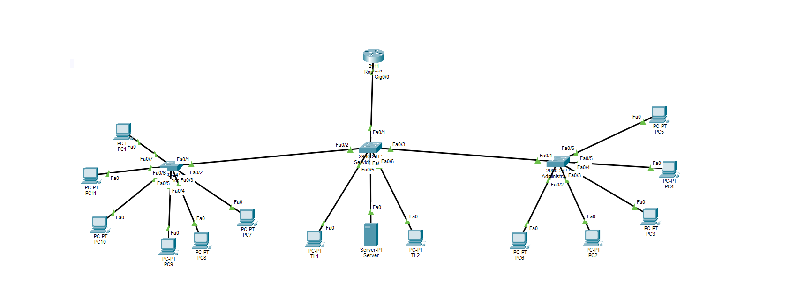
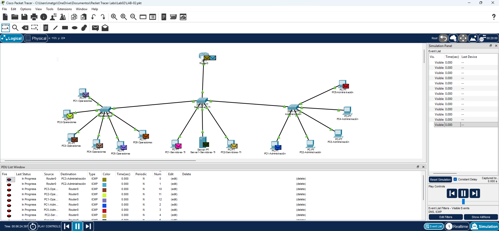

# Laboratorio 02 — VLANs y enrutamiento inter-VLAN

## 1. Objetivo

Diseñar e implementar una red empresarial segmentada mediante VLANs (Virtual Local Area Networks), configurar enlaces troncales utilizando el estándar IEEE 802.1Q y permitir la comunicación entre distintas VLANs mediante enrutamiento Router-on-a-Stick.

El laboratorio busca aplicar los conocimientos de direccionamiento IPv4 y VLSM desarrollados en el laboratorio anterior, incorporando conceptos de switching, segmentación lógica, encapsulación y enrutamiento entre subredes.

Además, se utilizarán comandos de verificación de Cisco IOS para comprobar el funcionamiento de la infraestructura y reforzar conocimientos de diagnóstico de redes.

## 2. Escenario

Una empresa está ampliando su infraestructura de red. Actualmente dispone de una red básica donde los equipos se conectan mediante switches y un router.

La empresa necesita separar lógicamente los dispositivos de distintos departamentos mediante VLANs, facilitando la organización de la red y la implementación de futuras políticas de seguridad.

Se utilizará como bloque principal la red privada `10.10.1.0/24`, que será dividida mediante VLSM considerando las necesidades de cada departamento.

| Área | VLAN ID | Equipos implementados | Capacidad requerida |
|---|---:|---|---:|
| Administración | 10 | 5 PCs | 45 hosts |
| Operaciones | 20 | 6 PCs | 28 hosts |
| TI / Servidores | 30 | 2 PCs y 1 servidor | 12 hosts |

### Dispositivos utilizados

- 1 router Cisco 2911.
- 3 switches Cisco 2960-24TT.
- 13 PCs.
- 1 servidor.
- Cableado Ethernet.

La infraestructura se implementó mediante una topología en estrella, utilizando el switch de TI / Servidores como dispositivo central para conectar los switches de Administración y Operaciones con el router.

## 3. Fundamentos técnicos

### 3.1 VLAN (Virtual Local Area Network)

Una VLAN permite segmentar una red física en diferentes redes lógicas de capa 2.

Cada VLAN constituye un dominio de broadcast independiente, permitiendo separar el tráfico de los distintos departamentos sin necesidad de utilizar una infraestructura física exclusiva para cada uno.

Los dispositivos pertenecientes a una misma VLAN pueden comunicarse mediante switching de capa 2, mientras que la comunicación entre VLANs diferentes requiere un dispositivo de capa 3.

### 3.2 Puertos access

Un puerto access permite conectar un dispositivo final a una VLAN determinada.

El switch asocia las tramas recibidas por dicho puerto con la VLAN configurada, permitiendo que el dispositivo forme parte de una red lógica independientemente de su ubicación física.

### 3.3 Enlaces trunk y encapsulación IEEE 802.1Q

Un enlace trunk permite transportar tráfico de múltiples VLANs mediante una misma conexión física.

El estándar IEEE 802.1Q incorpora una etiqueta en las tramas Ethernet para identificar la VLAN a la que pertenecen.

En este laboratorio se utilizaron enlaces trunk entre los switches y entre el switch central y el router, permitiendo transportar las VLANs 10, 20 y 30.

La VLAN nativa se mantuvo con su valor predeterminado, VLAN 1, mientras que la lista de VLANs permitidas en los enlaces troncales se limitó a las VLANs 10, 20 y 30.

### 3.4 Router-on-a-Stick

Router-on-a-Stick es una técnica de enrutamiento inter-VLAN que permite utilizar una única interfaz física de un router para comunicar múltiples VLANs.

Para ello, se crean subinterfaces lógicas asociadas a diferentes identificadores VLAN mediante encapsulación `dot1Q`.

Cada subinterfaz dispone de una dirección IPv4 que funciona como gateway predeterminado para los dispositivos de su VLAN.

### 3.5 Aprendizaje de direcciones MAC

Los switches de capa 2 mantienen una tabla de direcciones MAC que relaciona las direcciones físicas de los dispositivos con los puertos y VLANs correspondientes.

El aprendizaje se realiza a partir de las direcciones MAC de origen de las tramas recibidas.

Esta información permite reenviar las tramas Ethernet hacia el puerto correspondiente cuando la dirección MAC de destino es conocida, evitando inundaciones innecesarias dentro de la VLAN.

## 4. Diseño de direccionamiento IPv4

Se seleccionó la red privada `10.10.1.0/24` como bloque principal para la infraestructura.

Mediante VLSM se dividió la red en tres subredes independientes, considerando los requerimientos de capacidad de cada departamento.

| VLAN | Área | Red / Prefijo | Máscara | Rango de hosts utilizables | Broadcast | Hosts utilizables |
|---|---|---|---|---|---|---:|
| 10 | Administración | `10.10.1.0/26` | `255.255.255.192` | `10.10.1.1 - 10.10.1.62` | `10.10.1.63` | 62 |
| 20 | Operaciones | `10.10.1.64/27` | `255.255.255.224` | `10.10.1.65 - 10.10.1.94` | `10.10.1.95` | 30 |
| 30 | TI / Servidores | `10.10.1.96/28` | `255.255.255.240` | `10.10.1.97 - 10.10.1.110` | `10.10.1.111` | 14 |

Las subredes no presentan solapamientos y permiten reservar direcciones para futuras ampliaciones.

## 5. Asignación de gateways

Se utilizó la primera dirección IPv4 utilizable de cada subred como gateway predeterminado.

A diferencia del laboratorio anterior, estas direcciones fueron configuradas en subinterfaces lógicas de una única interfaz física del router.

| VLAN | Área | Subinterfaz | Gateway | Encapsulación |
|---|---|---|---|---|
| 10 | Administración | `G0/0.10` | `10.10.1.1` | `dot1Q 10` |
| 20 | Operaciones | `G0/0.20` | `10.10.1.65` | `dot1Q 20` |
| 30 | TI / Servidores | `G0/0.30` | `10.10.1.97` | `dot1Q 30` |

La interfaz física `GigabitEthernet0/0` fue habilitada mediante el comando `no shutdown`, sin asignarle directamente una dirección IPv4.

## 6. Cálculos realizados

Para determinar la capacidad de cada subred se utilizó la fórmula:

`Hosts utilizables = 2^h - 2`

Donde `h` representa la cantidad de bits disponibles para hosts.

### Administración — VLAN 10

- Dispositivos requeridos: 45.
- Bits de host: 6.
- Prefijo: `/26`.
- Direcciones totales: `2^6 = 64`.
- Hosts utilizables: `64 - 2 = 62`.
- Máscara: `255.255.255.192`.

### Operaciones — VLAN 20

- Dispositivos requeridos: 28.
- Bits de host: 5.
- Prefijo: `/27`.
- Direcciones totales: `2^5 = 32`.
- Hosts utilizables: `32 - 2 = 30`.
- Máscara: `255.255.255.224`.

### TI / Servidores — VLAN 30

- Dispositivos requeridos: 12.
- Bits de host: 4.
- Prefijo: `/28`.
- Direcciones totales: `2^4 = 16`.
- Hosts utilizables: `16 - 2 = 14`.
- Máscara: `255.255.255.240`.

## 7. Validaciones del diseño

- Las tres subredes pertenecen al bloque original `10.10.1.0/24`.
- Los bloques respetan los límites correspondientes a sus prefijos.
- No existe solapamiento entre las subredes.
- Cada VLAN dispone de una subred IPv4 independiente.
- Los gateways pertenecen a los rangos de hosts utilizables.
- La capacidad de cada subred cubre los requerimientos de dispositivos, incluyendo la dirección reservada para el gateway.
- Las VLANs se transportan mediante enlaces trunk configurados con IEEE 802.1Q.

El espacio desde `10.10.1.112` hasta `10.10.1.255` permanece sin asignar y puede utilizarse para futuras ampliaciones, respetando los límites de las nuevas subredes.

### 7.1 Implementación en Cisco Packet Tracer

El diseño fue implementado utilizando un router Cisco 2911, tres switches Cisco 2960, trece PCs y un servidor.

Se seleccionó una topología en estrella para facilitar la distribución de los dispositivos y permitir futuras ampliaciones de la infraestructura.

#### Topología de red

  <a href="evidencias/Topologia-Lab-02.png">🖼️ Ver topología completa</a>
  &nbsp; | &nbsp;
  <a href="evidencias/LAB-02.pkt?raw=1">📥 Descargar laboratorio (.pkt)</a>

#### Configuración realizada

- Creación de las VLANs 10, 20 y 30 en los switches.
- Asignación de puertos access según el departamento correspondiente.
- Configuración de enlaces trunk entre los switches.
- Configuración de un enlace trunk entre el switch central y el router.
- Restricción de las VLANs permitidas en los enlaces trunk.
- Habilitación de la interfaz física `GigabitEthernet0/0` del router.
- Creación de subinterfaces lógicas mediante encapsulación `dot1Q`.
- Configuración de gateways para cada VLAN.
- Asignación manual de direcciones IPv4, máscaras y gateways en los dispositivos finales.

#### Distribución de puertos access

| Switch | Puertos | VLAN | Área |
|---|---|---:|---|
| SW1 — TI / Servidores | `Fa0/4 - Fa0/6` | 30 | TI / Servidores |
| SW2 — Operaciones | `Fa0/2 - Fa0/7` | 20 | Operaciones |
| SW3 — Administración | `Fa0/2 - Fa0/6` | 10 | Administración |

#### Distribución de enlaces trunk

| Dispositivo | Puerto | Dispositivo remoto | Puerto remoto | VLANs permitidas |
|---|---|---|---|---|
| SW1 | `Fa0/1` | Router | `G0/0` | 10, 20, 30 |
| SW1 | `Fa0/2` | SW2 — Operaciones | `Fa0/1` | 10, 20, 30 |
| SW1 | `Fa0/3` | SW3 — Administración | `Fa0/1` | 10, 20, 30 |

En este laboratorio no se implementaron DHCP, ACLs ni mecanismos de seguridad de puertos, ya que estos contenidos se abordarán en laboratorios posteriores.

### 7.2 Verificación de dispositivos de red

Se utilizaron comandos de Cisco IOS para comprobar el estado operativo de las interfaces, las VLANs, los enlaces trunk, las tablas de enrutamiento y el aprendizaje de direcciones MAC.

| Comando | Propósito | Resultado |
|---|---|---|
| `show ip interface brief` | Verificar interfaces, subinterfaces y direcciones IPv4 | Interfaces utilizadas operativas |
| `show ip route` | Comprobar las redes conocidas por el router | Tres rutas conectadas y tres rutas locales |
| `show interfaces g0/0.10` | Verificar la encapsulación de la subinterfaz | IEEE 802.1Q, VLAN 10 |
| `show ip interface g0/0.10` | Comprobar los parámetros IPv4 | Gateway y prefijo correctos |
| `show vlan brief` | Verificar VLANs y asignación de puertos access | VLANs 10, 20 y 30 activas |
| `show interfaces trunk` | Comprobar enlaces troncales y VLANs permitidas | Trunks operativos |
| `show mac address-table` | Verificar el aprendizaje de direcciones MAC | Aprendizaje dinámico comprobado |
| `show cdp neighbors` | Identificar dispositivos vecinos | Conexiones coherentes con la topología |

#### Verificación de la tabla de enrutamiento

Mediante el comando `show ip route` se comprobó que el router dispone de las siguientes redes conectadas directamente:

| Código | Red de destino | Interfaz |
|---|---|---|
| C | `10.10.1.0/26` | `G0/0.10` |
| C | `10.10.1.64/27` | `G0/0.20` |
| C | `10.10.1.96/28` | `G0/0.30` |

También se comprobaron las rutas locales correspondientes a las direcciones IPv4 de las subinterfaces.

No fue necesario configurar rutas estáticas ni protocolos de enrutamiento dinámico, debido a que las tres subredes se encuentran conectadas directamente al router.

#### Verificación del aprendizaje de direcciones MAC

Inicialmente, las tablas MAC de los switches presentaban pocas entradas dinámicas correspondientes a los dispositivos finales.

Para comprobar el aprendizaje de direcciones MAC, se generó tráfico ICMP desde un equipo de Operaciones hacia otro equipo de la misma VLAN y hacia su gateway.

Posteriormente, mediante el comando `show mac address-table`, se identificaron nuevas entradas dinámicas:

| VLAN | Dirección MAC | Puerto |
|---|---|---|
| 20 | `0004.9a5b.7101` | `Fa0/1` |
| 20 | `0090.0c6e.c53e` | `Fa0/3` |
| 20 | `00d0.baad.10b9` | `Fa0/7` |

La dirección MAC aprendida por el puerto `Fa0/1` corresponde al router, mientras que las direcciones aprendidas por los puertos access corresponden a dispositivos finales de la VLAN 20.

Esta prueba permitió comprobar el aprendizaje dinámico de direcciones MAC y comprender cómo los switches utilizan esta información para reenviar tramas Ethernet.

### 7.3 Pruebas de conectividad

Se realizaron pruebas mediante `ping` para comprobar la comunicación dentro de una misma VLAN, el acceso a los gateways y el enrutamiento entre VLANs diferentes.

| Origen | Destino | Tipo de conectividad | Resultado |
|---|---|---|---|
| Operaciones | Operaciones | Intra-VLAN | Exitosa |
| Administración | Operaciones | Inter-VLAN | Exitosa |
| Operaciones | Administración | Inter-VLAN | Exitosa |
| Operaciones | TI / Servidores | Inter-VLAN | Exitosa |
| TI / Servidores | Operaciones | Inter-VLAN | Exitosa |
| Administración | TI / Servidores | Inter-VLAN | Exitosa |
| TI / Servidores | Administración | Inter-VLAN | Exitosa |
| Administración | Gateway VLAN 10 | Acceso al router | Exitosa |
| Operaciones | Gateway VLAN 20 | Acceso al router | Exitosa |
| TI / Servidores | Gateway VLAN 30 | Acceso al router | Exitosa |

#### Prueba de enrutamiento mediante tracert

Se ejecutó el comando `tracert` desde un equipo de Administración hacia un equipo de Operaciones con dirección IPv4 `10.10.1.69`.

Resultado obtenido:

    C:\>tracert 10.10.1.69

    Tracing route to 10.10.1.69 over a maximum of 30 hops:

      1   0 ms   3 ms   0 ms   10.10.1.1
      2   0 ms   3 ms   0 ms   10.10.1.69

    Trace complete.

| Salto | Dirección IPv4 | Dispositivo |
|---|---|---|
| 1 | `10.10.1.1` | Gateway de Administración |
| 2 | `10.10.1.69` | Equipo de destino en Operaciones |

La prueba permitió comprobar que el tráfico entre ambas VLANs atraviesa el router antes de alcanzar su destino.

Los switches de capa 2 no aparecen como saltos intermedios, debido a que no decrementan el campo TTL de los paquetes IPv4.

#### Simulación de tráfico ICMP

Se utilizó el modo Simulation de Cisco Packet Tracer para observar el recorrido de los paquetes ICMP a través de la infraestructura.

Mediante esta simulación se verificó la comunicación entre los dispositivos finales y el router, obteniendo resultados exitosos en las pruebas realizadas.

### 7.4 Evidencias del laboratorio

Las siguientes capturas permiten consultar la implementación, verificar el estado de los dispositivos y comprobar los resultados de las pruebas realizadas.

**Configuración y verificación del router:**

- [Estado de interfaces y subinterfaces](evidencias/Router-Interfaces.png)
- [Tabla de enrutamiento IPv4](evidencias/Router-Tabla-Enrutamiento.png)
- [Verificación de encapsulación IEEE 802.1Q](evidencias/Router-Encapsulacion-8021Q.png)

**Configuración y verificación de switches:**

- [VLANs del switch central](evidencias/SW1-VLANs.png)
- [Enlaces trunk del switch central](evidencias/SW1-Trunks.png)
- [VLANs del switch de Operaciones](evidencias/SW2-VLANs.png)
- [Enlaces trunk del switch de Operaciones](evidencias/SW2-Trunks.png)
- [VLANs del switch de Administración](evidencias/SW3-VLANs.png)
- [Enlaces trunk del switch de Administración](evidencias/SW3-Trunks.png)
- [Tabla MAC del switch de Operaciones](evidencias/SW2-Tabla-MAC.png)
- [Descubrimiento de vecinos mediante CDP](evidencias/SW1-CDP-Neighbors.png)

**Pruebas de conectividad inter-VLAN:**

- [Ping desde Administración hacia Operaciones](evidencias/Ping-ADM-OPER.png)
- [Ping desde Operaciones hacia Administración](evidencias/Ping-OPER-ADM.png)
- [Ping desde Operaciones hacia TI / Servidores](evidencias/Ping-OPER-TI.png)
- [Ping desde TI / Servidores hacia Operaciones](evidencias/Ping-TI-OPER.png)
- [Ping desde Administración hacia TI / Servidores](evidencias/Ping-ADM-TI.png)
- [Ping desde TI / Servidores hacia Administración](evidencias/Ping-TI-ADM.png)

**Pruebas de conectividad hacia los gateways:**

- [Ping hacia gateway de Administración](evidencias/Ping-ADM-Gateway.png)
- [Ping hacia gateway de Operaciones](evidencias/Ping-OPER-Gateway.png)
- [Ping hacia gateway de TI / Servidores](evidencias/Ping-TI-Gateway.png)

**Pruebas de diagnóstico y simulación:**

- [Prueba de enrutamiento mediante tracert](evidencias/Tracert-Inter-VLAN.png)
- [Simulación de tráfico ICMP](evidencias/Simulacion-ICMP.png)

[Consultar carpeta completa de evidencias](evidencias/)

## 8. Conclusiones

La implementación de VLANs permitió segmentar lógicamente la infraestructura de red, separando los dispositivos de Administración, Operaciones y TI / Servidores en diferentes dominios de broadcast.

Mediante enlaces trunk y encapsulación IEEE 802.1Q fue posible transportar múltiples VLANs a través de una misma conexión física entre los dispositivos de red.

La implementación de Router-on-a-Stick permitió establecer comunicación entre las diferentes subredes utilizando una única interfaz física del router, a diferencia del diseño realizado en el laboratorio anterior.

Las verificaciones mediante comandos de Cisco IOS permitieron comprobar el estado de las interfaces, las tablas de enrutamiento, la asignación de VLANs, los enlaces troncales y el aprendizaje dinámico de direcciones MAC.

Este laboratorio permitió reforzar conocimientos de direccionamiento IPv4, switching, segmentación lógica, enrutamiento inter-VLAN y diagnóstico de redes.

## 9. Estado del laboratorio

- **Diseño y cálculos VLSM:** completados.
- **Diseño de topología en estrella:** completado.
- **Implementación en Cisco Packet Tracer:** completada.
- **Creación y configuración de VLANs:** completada.
- **Configuración de puertos access:** completada.
- **Configuración de enlaces trunk:** completada.
- **Configuración Router-on-a-Stick:** completada.
- **Asignación de direcciones IPv4:** completada.
- **Verificación mediante comandos Cisco IOS:** realizada.
- **Pruebas de conectividad intra-VLAN e inter-VLAN:** realizadas.
- **Simulación de tráfico ICMP:** realizada.
- **Evidencias de configuración y conectividad:** documentadas mediante capturas.

## 10. Herramientas y tecnologías

- **Cisco Packet Tracer:** diseño, implementación y simulación de la infraestructura.
- **Cisco IOS:** configuración y verificación de dispositivos de red.
- **IPv4 y CIDR:** planificación del direccionamiento.
- **VLSM:** división de la red en subredes de distintos tamaños.
- **VLANs:** segmentación lógica de la infraestructura.
- **IEEE 802.1Q:** etiquetado y transporte de múltiples VLANs.
- **Router-on-a-Stick:** enrutamiento entre VLANs mediante subinterfaces.
- **Tablas MAC:** aprendizaje y reenvío de tramas Ethernet.
- **CDP:** descubrimiento de dispositivos vecinos.
- **ICMP:** comprobación de conectividad.
- **`ping`:** verificación de comunicación entre dispositivos.
- **`tracert`:** identificación de saltos de capa 3.
- **Comandos `show`:** verificación operativa y diagnóstico de redes.
